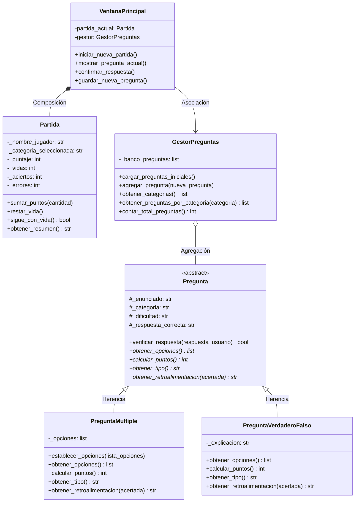

# Informe Técnico — Trivia POO: Juego de Preguntas Interactivo

## 1. Análisis del problema
* **Necesidad identificada:** Los estudiantes suelen necesitar herramientas prácticas para autoevaluarse en distintos temas académicos. Un juego de preguntas interactivo permite transformar el repaso teórico en una actividad dinámica con retroalimentación inmediata.
* **Público objetivo:** Estudiantes universitarios y cualquier usuario interesado en poner a prueba sus conocimientos en áreas como Programación, Ciencia y Cultura General, o en crear sus propios bancos de preguntas durante una sesión de estudio.
* **Funcionalidades principales:**
  1. Inicio de partida personalizada por nombre de jugador y filtrado por categoría.
  2. Evaluación interactiva de preguntas de distinto tipo (Selección Múltiple y Verdadero/Falso) con cálculo diferenciado de puntos, control de 3 vidas y temporizador de 20 segundos por pregunta.
  3. Creación y registro de nuevas preguntas en memoria con validación de integridad de datos.
* **Limitaciones del alcance:** Conforme a los lineamientos del proyecto, el banco de preguntas y los datos de la partida se administran en memoria principal (listas de objetos) sin requerir un motor de base de datos externo, garantizando que el programa funcione en cualquier computador con Python estándar.

---

## 2. Diseño inicial
Para resolver el problema aplicando Programación Orientada a Objetos de nivel 1 de manera clara y ordenada, se identificaron las siguientes clases antes de escribir el código:

1. **`Pregunta` (Clase Abstracta):** Representa el concepto general de una pregunta. Define los atributos comunes (`_enunciado`, `_categoria`, `_dificultad`, `_respuesta_correcta`), el método común `verificar_respuesta()` y declara como métodos abstractos `obtener_opciones()`, `calcular_puntos()`, `obtener_tipo()` y `obtener_retroalimentacion()`.
2. **`PreguntaMultiple` (Clase Derivada):** Hereda de `Pregunta`. Especializa el comportamiento almacenando una lista de opciones (`_opciones`), validando que la respuesta correcta forme parte de dicha lista y otorgando mayor puntaje (10, 20 o 30 puntos según la dificultad).
3. **`PreguntaVerdaderoFalso` (Clase Derivada):** Hereda de `Pregunta`. Especializa el comportamiento restringiendo las opciones a `["Verdadero", "Falso"]`, añadiendo una explicación educativa (`_explicacion`) y otorgando un puntaje ajustado (5, 10 o 15 puntos).
4. **`Partida` (Clase de Modelo de Estado):** Representa la sesión activa del jugador. Protege mediante encapsulamiento los atributos `_nombre_jugador`, `_puntaje`, `_vidas`, `_aciertos` y `_errores`.
5. **`GestorPreguntas` (Clase de Servicio):** Administra la colección de objetos `Pregunta` en memoria, carga el banco inicial, filtra preguntas por categoría, las desordena aleatoriamente y permite agregar nuevas preguntas.
6. **`VentanaPrincipal` (Clase de Interfaz Gráfica):** Construye las tres pantallas en `Tkinter` (Menú, Juego y Registro), captura los eventos del usuario y delega la lógica en `GestorPreguntas` y `Partida`.

---

## 3. Arquitectura
El proyecto está organizado en tres capas principales (`modelos`, `servicios` e `interfaz`) para cumplir con el principio de **separación de responsabilidades**:

* **Capa de Modelos (`modelos/`):** Contiene únicamente las clases del dominio y sus validaciones internas. No tiene ningún conocimiento de `Tkinter`.
* **Capa de Servicios (`servicios/`):** Contiene `GestorPreguntas`, que coordina el almacenamiento en memoria y la búsqueda/filtrado de preguntas.
* **Capa de Interfaz (`interfaz/`):** Contiene `VentanaPrincipal`, que muestra los datos al usuario y captura los clics en botones, llamando a los métodos de `GestorPreguntas` y `Partida`.

### Diagrama de Clases (Mermaid)


---

## 4. Bibliotecas utilizadas
Además de `tkinter` para la interfaz gráfica y `abc` para la abstracción, se utilizó el módulo **`random`** de la biblioteca estándar de Python:
* **Qué problema resuelve:** Evita que las preguntas aparezcan siempre en el mismo orden cada vez que el jugador inicia una partida.
* **Por qué se seleccionó:** Viene integrada en Python, es muy sencilla de usar mediante `random.shuffle(lista)` y no requiere instalaciones adicionales que puedan fallar en otros equipos.
* **Dónde se utiliza:** En `servicios/gestor_preguntas.py`, dentro del método `obtener_preguntas_por_categoria()`.

---

## 5. Aplicación de POO

A continuación se detalla exactamente dónde y cómo se aplicó cada concepto obligatorio de Programación Orientada a Objetos dentro del proyecto:

| Concepto | Clase o método | Archivo | Explicación |
| :--- | :--- | :--- | :--- |
| **Clases y objetos** | `PreguntaMultiple`, `PreguntaVerdaderoFalso`, `Partida`, `GestorPreguntas`, `VentanaPrincipal` | `modelos/`, `servicios/`, `interfaz/` | Cada clase tiene una responsabilidad única. En `GestorPreguntas.cargar_preguntas_iniciales()` se instancian 10 objetos de preguntas iniciales. |
| **Encapsulamiento** | Atributos `_puntaje`, `_vidas`, `_nombre_jugador` y métodos `sumar_puntos()`, `restar_vida()`, `@nombre_jugador.setter` | `modelos/partida.py` y `modelos/pregunta.py` | Protege los datos para que el nombre o enunciado no estén vacíos (`ValueError`), el puntaje solo aumente con valores positivos y las vidas nunca sean menores que `0`. |
| **Herencia** | `PreguntaMultiple(Pregunta)` y `PreguntaVerdaderoFalso(Pregunta)` | `modelos/pregunta_multiple.py` y `modelos/pregunta_verdadero_falso.py` | Ambas clases hijas reutilizan los atributos y el método `verificar_respuesta()` de `Pregunta` llamando a `super().__init__(...)`. |
| **Polimorfismo** | `calcular_puntos()`, `obtener_opciones()`, `obtener_retroalimentacion()` | `modelos/pregunta_multiple.py`, `modelos/pregunta_verdadero_falso.py` e `interfaz/ventana_principal.py` | `VentanaPrincipal` invoca `pregunta.calcular_puntos()` y `pregunta.obtener_opciones()` sin saber de qué subclase es la pregunta; cada subclase calcula un puntaje distinto y devuelve 4 o 2 opciones. |
| **Abstracción** | Clase `Pregunta(ABC)` con `@abstractmethod` | `modelos/pregunta.py` | Establece un contrato obligatorio: cualquier nuevo tipo de pregunta debe implementar `obtener_opciones()`, `calcular_puntos()`, `obtener_tipo()` y `obtener_retroalimentacion()`. |
| **Relaciones** | Asociación, Agregación y Composición | `servicios/gestor_preguntas.py` e `interfaz/ventana_principal.py` | **Agregación:** `GestorPreguntas` agrupa objetos `Pregunta`. **Composición:** `VentanaPrincipal` crea y destruye el objeto `Partida` en cada juego. **Asociación:** `VentanaPrincipal` consulta a `GestorPreguntas`. |

### Fragmentos de código representativos

**1. Abstracción (`modelos/pregunta.py`):**
```python
from abc import ABC, abstractmethod

class Pregunta(ABC):
    @abstractmethod
    def calcular_puntos(self):
        """Calcula cuántos puntos da la pregunta según su tipo y dificultad."""
        pass
```

**2. Herencia y Polimorfismo (`modelos/pregunta_multiple.py` vs `modelos/pregunta_verdadero_falso.py`):**
```python
# En PreguntaMultiple: da 10, 20 o 30 puntos porque tiene 4 opciones
def calcular_puntos(self):
    if self._dificultad == "Fácil":
        return 10
    elif self._dificultad == "Media":
        return 20
    elif self._dificultad == "Difícil":
        return 30
    return 10

# En PreguntaVerdaderoFalso: da 5, 10 o 15 puntos porque solo hay 2 opciones
def calcular_puntos(self):
    if self._dificultad == "Fácil":
        return 5
    elif self._dificultad == "Media":
        return 10
    elif self._dificultad == "Difícil":
        return 15
    return 5
```

**3. Encapsulamiento con validación real (`modelos/partida.py`):**
```python
@nombre_jugador.setter
def nombre_jugador(self, nuevo_nombre):
    nombre_limpio = str(nuevo_nombre).strip()
    if len(nombre_limpio) == 0:
        raise ValueError("El nombre del jugador no puede estar vacío.")
    self._nombre_jugador = nombre_limpio

def restar_vida(self):
    if self._vidas > 0:
        self._vidas = self._vidas - 1
    self._errores = self._errores + 1
```

---

## 6. Construcción de la interfaz
* **Biblioteca seleccionada:** Se utilizó `tkinter` junto con `ttk` y `messagebox` porque viene integrada en Python, es muy estable y permite trabajar claramente con programación orientada a eventos.
* **Diseño por pantallas (Frames):** En lugar de abrir muchas ventanas emergentes desordenadas, `VentanaPrincipal` administra tres paneles (`frame_menu`, `frame_juego` y `frame_registro`) que se intercambian dinámicamente con `pack()` y `pack_forget()`.
* **Controles implementados:**
  * `Entry` para cajas de texto (nombre del jugador, enunciados y opciones).
  * `ttk.Combobox` para listas desplegables (categoría, tipo de pregunta y dificultad).
  * `Radiobutton` enlazados a un `tk.StringVar()` para seleccionar una respuesta.
  * `Button` con el parámetro `command=...` para conectar los clics del usuario con los métodos de la clase.
* **Eventos, Callbacks y Temporizador:**
  * Cada botón ejecuta un método callback como `self.iniciar_nueva_partida`, `self.confirmar_respuesta` o `self.guardar_nueva_pregunta`.
  * Para el temporizador de 20 segundos se utilizó el evento temporal `self.raiz.after(1000, self.ejecutar_temporizador)`, evitando que la ventana se congele (como ocurriría si se usara `time.sleep()`).

---

## 7. Proceso de desarrollo
1. **Formulación de la idea:** Se eligió el juego de preguntas interactivo porque permite demostrar de forma muy natural la diferencia entre una clase base (`Pregunta`) y distintos tipos de preguntas con reglas propias.
2. **Identificación de funcionalidades:** Se definieron las 3 funcionalidades clave: jugar filtrando por categoría, responder con reloj/vidas/puntaje polimórfico, y agregar nuevas preguntas al banco.
3. **Diseño de clases:** Se estructuró primero la carpeta `modelos/` asegurando que las validaciones funcionaran sin depender de la interfaz.
4. **Construcción de la lógica:** Se programó `GestorPreguntas` en `servicios/` con 10 preguntas variadas de prueba.
5. **Desarrollo de la interfaz e integración:** Se creó `VentanaPrincipal` en `interfaz/` conectando los formularios y botones con los objetos de `Partida` y `GestorPreguntas`.
6. **Pruebas y correcciones:** Se creó `pruebas/prueba_consola.py` y se probaron casos válidos e inválidos desde la interfaz gráfica.

---

## 8. Pruebas

Se realizaron pruebas funcionales y de validación de errores tanto en consola (`pruebas/prueba_consola.py`) como en la interfaz gráfica:

| Prueba | Acción realizada | Resultado esperado | Resultado obtenido |
| :--- | :--- | :--- | :--- |
| **Prueba 1: Intento de inicio con datos inválidos (Caso de Error)** | Dejar el campo "Nombre del Jugador" vacío o solo con espacios y presionar "Iniciar Partida". | El setter de `Partida` lanza `ValueError` y la interfaz muestra una ventana `messagebox.showwarning` indicando que el nombre no puede estar vacío, sin iniciar el juego. | El sistema mostró la alerta de advertencia y permaneció en el menú principal sin bloquearse. |
| **Prueba 2: Evaluación polimórfica de preguntas y vidas** | Iniciar partida en categoría "Programación", acertar una pregunta Múltiple Fácil y fallar una de Verdadero/Falso. | Al acertar la múltiple suma 10 puntos; al fallar la de V/F resta 1 vida (quedando en 2 vidas) y muestra la nota explicativa propia de la clase `PreguntaVerdaderoFalso`. | El marcador subió a 10 puntos, luego las vidas bajaron a 2 y se mostró en pantalla la explicación de la respuesta. |
| **Prueba 3: Registro de nueva pregunta y validación de opciones** | Ir a "Agregar Nueva Pregunta", intentar guardar una pregunta múltiple cuya respuesta correcta no está entre las opciones; luego corregirla y guardar. | Primero debe mostrar error indicando que la respuesta correcta debe estar dentro de las opciones; al corregirla, debe guardarla y subir el contador del menú de 10 a 11 preguntas. | Mostró el mensaje de validación correctamente y, tras incluir la respuesta en las opciones, registró la pregunta aumentando el total a 11. |

---

## 9. Problemas y soluciones

Durante el desarrollo se presentaron dos dificultades técnicas importantes:

1. **Problema 1: Bloqueo de la ventana al intentar hacer el temporizador con `time.sleep()`**
   * **Diagnóstico:** Inicialmente se pensó usar un ciclo `while` con `time.sleep(1)` para descontar los 20 segundos de cada pregunta, pero en `Tkinter` eso congela toda la ventana gráfica e impide que el usuario haga clic en los botones.
   * **Solución:** Se investigó el método `after(1000, funcion)` propio de `Tkinter`, que programa la ejecución del método `ejecutar_temporizador()` cada segundo sin congelar la interfaz, y `after_cancel()` para detener el reloj cuando el jugador confirma su respuesta.

2. **Problema 2: Cambiar entre preguntas de 4 opciones y preguntas de 2 opciones en la misma pantalla**
   * **Diagnóstico:** Las preguntas de Selección Múltiple necesitan mostrar 4 `Radiobutton`, mientras que las de Verdadero/Falso solo necesitan 2. Si se creaban botones nuevos en cada pregunta sin borrar los anteriores, se acumulaban en la pantalla.
   * **Solución:** Se crearon 4 `Radiobutton` fijos en una lista (`self.botones_radio`) al construir la ventana. En cada pregunta se ocultan primero con `pack_forget()` y luego un ciclo `for` recorre `pregunta.obtener_opciones()` para mostrar únicamente los 2 o 4 botones necesarios.

---

## 10. Conclusiones
* **Conocimientos aplicados:** El desarrollo de este proyecto permitió comprender cómo los conceptos de POO (especialmente la herencia, las clases abstractas y el polimorfismo) facilitan que la interfaz gráfica trate a distintos tipos de preguntas con el mismo código sin llenarse de condicionales repetitivos.
* **Importancia del encapsulamiento:** Centralizar las validaciones dentro de las clases (`Pregunta` y `Partida`) usando `@property` y excepciones `ValueError` hizo que fuera muy sencillo capturar errores en la interfaz gráfica con bloques `try / except`.
* **Trabajo futuro y mejoras posibles:** En una versión futura se podría agregar guardado de puntajes históricos en un archivo local para tener una tabla de récords (ranking) y añadir sonidos al acertar o fallar una respuesta.
